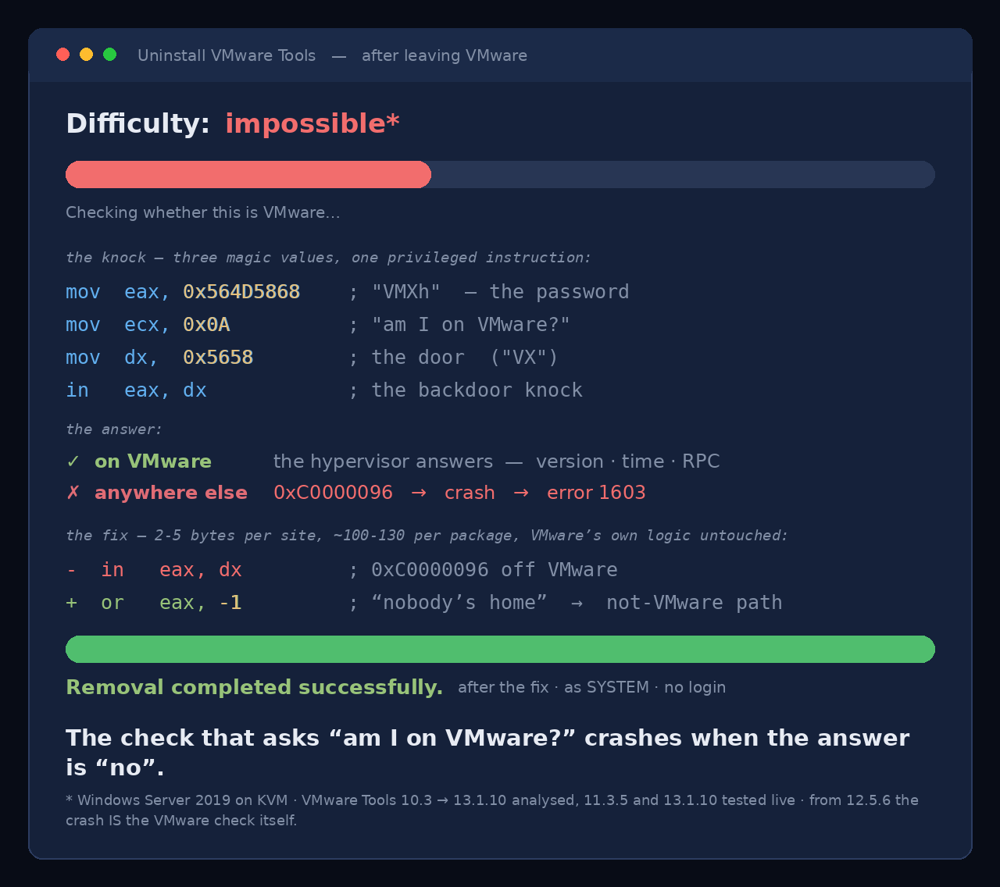
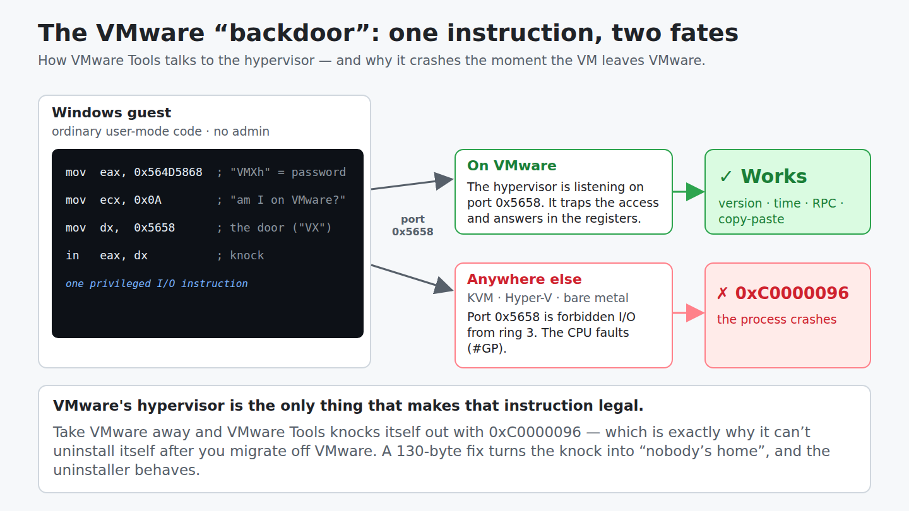

# make-tools-behave

*because VMware Tools won't.*

> VMware Tools can't uninstall itself once a VM leaves VMware — the uninstaller crashes asking *"am I still on VMware?"* with an instruction that only works **on** VMware. This is the ~130-byte fix for the check Broadcom couldn't be bothered to put a seatbelt on. For everyone escaping to KVM / Proxmox.

VMware Tools installs itself in four seconds and then, the moment your VM dares to leave VMware, refuses to uninstall for the rest of time. Not because removal is hard — because the uninstaller's very first move is to lean out the window and bellow **"AM I STILL ON VMWARE?"** using a CPU instruction that only works… on VMware. Off it, that instruction is illegal, the helper process face-plants with `0xC0000096`, removal "fails" with `1603`, and your migration tooling gets the blame. This repo is **~130 bytes** that swap that one suicidal question for the answer a sane machine already knows — *"no"* — so the uninstaller finishes the way it always could have. It patches *your own* installed copy, ships **zero** VMware code, and touches **no** kernel drivers. Broadcom has had years and an engineering org. This took a couple of evenings.



---

## TL;DR

- **Symptom:** VMware Tools won't uninstall after a VM is migrated off VMware (KVM, Proxmox, Hyper-V, bare metal). On Windows Server 2019 the removal hard-fails with **`1603`**; on 2016 / 2022 / 2025 it often "succeeds" while a helper silently crashes.
- **Root cause:** the uninstaller's custom actions call the VMware **backdoor** (`in eax, dx` on port `0x5658`) to talk to the hypervisor. That instruction is privileged; off VMware it raises `0xC0000096` (`STATUS_PRIVILEGED_INSTRUCTION`) and kills the action. One of the crashing calls is literally the *"am I on VMware?"* check.
- **Fix:** patch that one instruction to return `0xFFFFFFFF` — the exact value a non-VMware machine gives — so VMware's own *"not on VMware"* path runs and removal completes. ~2–5 bytes per site, ~100–130 bytes per package.
- **What it is not:** not a crack, not a VMware binary, not a kernel-driver hack. It edits the copy of the installer already cached on *your* machine.

Full, friendly write-up of the mechanism: **[docs/the-vmware-backdoor.md](docs/the-vmware-backdoor.md)**.

---

## The bug, precisely

VMware Tools talks to the hypervisor through the **backdoor**: load `EAX = 0x564D5868` ("VMXh"), `DX = 0x5658` ("VX"), `ECX = <command>`, then execute `in eax, dx`. On VMware the hypervisor is listening on that port and answers in the registers. Everywhere else, `in`/`out` are privileged I/O instructions that a user-mode (ring-3) process may not execute, so the CPU faults and Windows reports `0xC0000096`.



The uninstaller runs several **MSI custom actions** that use this channel. Depending on the Tools generation, the one that crashes is either:

- **`VM_LogStart`** (Tools ~10.3–12.1.x) — opens an RPC channel (`ECX = 0x1E`) to ship the install log to the host, or
- **`VM_CheckRequirements`** (Tools ~12.5+ / 13.x) — the version probe itself (`ECX = 0x0A`, GETVERSION, *"am I on VMware?"*).

The check for whether it is safe to talk to VMware **is itself** the unsafe thing. It faults instead of answering "no." Only Windows Server 2019 turns that crashed custom action into a fatal `1603`; the other versions let the installer march on, which is its own kind of wrong.

---

## The fix — exactly what changes

The patch finds every backdoor I/O site in the installer's custom-action code and replaces the instruction that *reads from the port* with one that *loads the all-ones value* — `0xFFFFFFFF` — into `EAX`, which is precisely what a real machine returns from an unhandled I/O port. The magic ("VMXh") is therefore never echoed back, VMware's own detection concludes "not on VMware," and the graceful path runs.

| Site | Before (reads the port) | After (returns "not VMware") |
|---|---|---|
| Standard backdoor read (x64) | `… in eax, dx` | `or eax, -1 ; nop` |
| Standard backdoor read (x86) | `… in eax, dx` | `or eax, -1` |
| High-bandwidth in/out (`rep ins`/`rep outs`, port `0x5659`) | `rep ins`/`rep outs` | `xor ebx, ebx` (clears the magic) |
| Inline version probe | `mov dx, 0x5658 ; in eax, dx` | `or eax, -1 ; nop` |

- **2–5 bytes per site, ~100–130 bytes per package.** No logic is removed — one "knock" is turned into "nobody's home."
- The all-ones answer is the documented behaviour of a non-VMware host, so every downstream branch is one VMware already wrote and tests.

### Which files it touches (every detail)

- The patch targets the **cached copy of the VMware Tools MSI** on the guest — `C:\Windows\Installer\<random>.msi` — not anything in `Program Files`, and not the running services.
- Inside that MSI (an OLE compound file) the custom-action helpers live as embedded streams in the **Binary** table: two DLLs, `_toolsinstutil.dll` and `_instutils.dll`, each embedded **several times** (one stream per custom-action component, across architectures) which works out to about **eight** streams in a typical package. The patch rewrites the instruction bytes **in place** inside every one of them.
- After patching, the DLL's Authenticode signature no longer matches (expected — it's an edited binary), but Windows Installer still loads and runs it, so the uninstall proceeds.
- **Kernel-mode drivers (`.sys`) are never touched.** Only the user-mode installer helper code is patched. VMXNET3 / PVSCSI / the VM memory-control driver are left exactly as they are (and on KVM the guest isn't using them anyway).

---

## Running it

> **Step by step, with copy-paste commands:** [docs/running.md](docs/running.md). The script: [`scripts/Fix-VMwareToolsUninstall.ps1`](scripts/Fix-VMwareToolsUninstall.ps1), run inside Windows. Optional: [`scripts/vmtfix.py`](scripts/vmtfix.py) makes the same fix from Linux, if you'd rather fix the cached `.msi` file outside the VM.

### A. In the guest — any Windows Server

1. Run `Fix-VMwareToolsUninstall.ps1` as Administrator or SYSTEM. It finds the cached VMware Tools MSI, backs it up, and patches the embedded custom-action DLL streams in place (the swap in the table above). Use `-DryRun` first to see what it would change.
2. Run the normal uninstall: `MsiExec.exe /x{PRODUCT-GUID} /quiet /norestart REBOOT=ReallySuppress`.

The removal now completes on the **first** attempt, including on Server 2019 where it previously died with `1603`.

### B. From the hypervisor, with no guest login (KVM / Proxmox)

If you migrated the VM yourself, you already own a credential-free, SYSTEM-level channel into it: the **QEMU guest agent** (`qemu-ga`), installed during conversion. You can apply the fix and remove Tools without ever logging into the guest:

```
# Proxmox: copy the patcher into the guest, then run it as SYSTEM, no guest credentials
pvesh create /nodes/$(hostname)/qemu/<vmid>/agent/file-write --file 'C:\Windows\Temp\Fix-VMwareToolsUninstall.ps1' --content "$(cat scripts/Fix-VMwareToolsUninstall.ps1)"
qm guest exec <vmid> --timeout 300 -- powershell.exe -NoProfile -ExecutionPolicy Bypass -File 'C:\Windows\Temp\Fix-VMwareToolsUninstall.ps1'
```

The libvirt (`virsh`) version, and the uninstall step, are in [docs/running.md](docs/running.md#2-from-the-kvm-host-with-no-guest-login-qemu-guest-agent).

The guest agent is **not** torn down by the Tools uninstaller (unlike VMware's own channel, which stops its service mid-removal), so it is a reliable place to drive this from. Everything it does is logged in the guest. This is a management agent you installed on a host you control — see [Scope & safety](#scope--safety).


---

## Proof of concept: the backdoor from an unprivileged user

[`examples/backdoor-poc.ps1`](examples/backdoor-poc.ps1) is a safe, self-contained demo. As an **ordinary, non-admin** user inside a Windows guest it knocks on the backdoor with a single instruction and reads host-provided facts about the VM (that it's on VMware, the product version, the host CPU speed) — information that sits *below* the guest OS's permission model.

It is **not** a VM escape: the guest can only ask, and the hypervisor decides what to answer. And it is safe to run anywhere — it uses the non-faulting `CPUID` check first and only performs the backdoor knock if it's actually on VMware, so off VMware it prints a note instead of crashing. That seatbelt is the exact one VMware forgot to put on its own uninstaller.

---

## Scope & safety

- **It patches your own installed copy.** This repository contains **no** VMware code or binaries. You run it against the Tools package already on your machine.
- **No kernel drivers are modified** — only the user-mode MSI custom-action helpers.
- **Test before a fleet.** Snapshot/clone one VM, confirm a clean removal, then roll out.
- **The safest move is still to remove VMware Tools *before* you migrate**, while you're still on VMware and the backdoor actually answers. This fix is for the very common case where that ship has already sailed and you're staring at a fleet of migrated VMs with Tools wedged on them.
- Editing a signed binary breaks its signature by design; that's expected and does not stop Windows Installer from running it.

---

## Version coverage

The same unguarded backdoor call is present across **VMware Tools 10.3 through 13.1.10**. The byte patterns and the two custom-action variants (`VM_LogStart` vs `VM_CheckRequirements`) are handled automatically. Verified against Windows Server **2016 / 2019 / 2022 / 2025**; the end-to-end "fails → patch → succeeds" cycle was exercised live on Server 2019 migrated to KVM, with Tools **11.3.5** and **13.1.10**.

---

## Status

- ✅ Root-cause write-up — [docs/the-vmware-backdoor.md](docs/the-vmware-backdoor.md)
- ✅ Backdoor proof-of-concept — [examples/backdoor-poc.ps1](examples/backdoor-poc.ps1)
- ✅ In-guest PowerShell patcher — [scripts/Fix-VMwareToolsUninstall.ps1](scripts/Fix-VMwareToolsUninstall.ps1)
- ✅ Optional: the same fix from Linux, on the cached `.msi` copied out of the VM — [scripts/vmtfix.py](scripts/vmtfix.py)
- ✅ How to run it, in the guest or from the KVM host through `qemu-ga` — [docs/running.md](docs/running.md)

---

## License

[MIT](LICENSE). Take it, patch it, ship it, sell it — just keep the copyright line. No warranty: it edits binaries, so test on a copy first.

---

*A parting gift from one VMware refugee to the next.*
